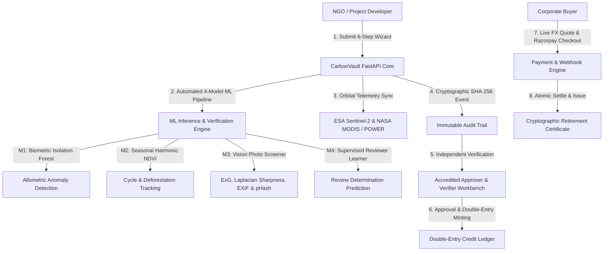

# CarbonVault — How It Works: Technical & Functional Architecture

CarbonVault is an enterprise-grade digital carbon credit MRV (Measurement, Reporting, and Verification) platform and marketplace. It connects verified nature-based carbon removal projects (reforestation, mangrove restoration, bamboo agroforestry) with corporate buyers through multi-spectral satellite telemetry, cryptographic ledger integrity, multi-model automated machine learning, and secure multi-currency payment settlement.

---

## 1. System Architecture



---

## 2. The 6-Step Project Creation Wizard (`/projects/new`)

The project creation wizard allows project developers to draft, validate, and submit carbon sequestration projects with real-time feedback and pre-flight validation.

### Wizard Features
- **Auto-Drafting in `localStorage`**: Edits are persisted automatically (`carbonvault_project_wizard_draft`). Unintentional tab reloads or network drops restore exact wizard state.
- **Dynamic Boundary Polygon Generator**: Entering a centroid and area automatically generates a realistic WKT polygon (`POLYGON(...)`) that matches geometry constraints.
- **Pre-Flight Screening Preview**: Developers can preview ML fraud screening checks before final submission.

### The 6 Progressive Steps:
1. **Basic Project Information**: Title, country, category (Reforestation, Mangrove, Bamboo, Agroforestry), developer entity name, and detailed narrative description & objectives.
2. **Location & Geospatial Boundary**: Centroid latitude/longitude, area in hectares, baseline land tenure, and GeoJSON/WKT boundary definition.
3. **Allometrics & Biomass Calculation**: Tree species, planting density, target tree count, expected annual sequestration rate ($tCO_2e/ha/yr$), and methodology standard (Verra VM0007, Gold Standard, CDM).
4. **Baseline Agroclimatology & Satellite Precheck**: Baseline NDVI historical mean, historical precipitation, temperature bands, and NASA POWER climate sync.
5. **Mandatory Documentation Gate**: Upload links or files for Land Title / Concession Proof, Environmental Impact Assessment, Baseline Survey, and Monitoring Protocol.
6. **Pre-Flight Screening & Review**: Multi-factor pre-submission screening check (boundary integrity, EXIF proximity, photo freshness, allometric density) with one-click submission.

---

## 3. Deep-Linkable Project Detail Page (`/projects/:id`)

Every project has an individual, deep-linkable URL (`https://final-carbon-vault.vercel.app/projects/:id`) with 8 specialized tabs and role-tailored action bars.

```
┌────────────────────────────────────────────────────────────────────────┐
│ Project Header: Title, Category, Location, Status Badge, Share URL     │
│ Quick Stats: Area (ha) │ Trees │ Gross Credits │ Available Balance      │
├────────────────────────────────────────────────────────────────────────┤
│ [1. Overview] [2. Evidence & ML] [3. Verification] [4. Satellite NDVI] │
│ [5. Credits & Pool] [6. Documents] [7. Audit Trail] [8. Settlement]    │
└────────────────────────────────────────────────────────────────────────┘
```

### The 8 Project Tabs:

#### Tab 1: Overview
- Complete project description and measurable conservation objectives queried directly from database records.
- Metadata summary: Developer identity, creation timestamp, geographical coordinates, and target crediting period.

#### Tab 2: Evidence & ML Photos
- Inspection of all submitted field evidence images.
- Automated ML Vision metrics displayed per photo:
  - **Excess Green Index (ExG)**: Color-space vegetation fraction ($2G - R - B$).
  - **Focus Sharpness**: NumPy Laplacian variance score ($\sigma^2_{\Delta}$). Detects blur or artificially downscaled images.
  - **EXIF Geolocation Verification**: Proximity check comparing photo GPS to project centroid ($< 25\text{ km}$).
  - **Screenshot Detection**: Detection of UI chrome, battery bars, or status artifacts.
  - **Perceptual Hash (pHash)**: Hamming distance calculation preventing recycled or duplicate photos across projects.

#### Tab 3: Verification & MRV
- ISO 14064-3 adherence checklist (Quantification, Monitoring, Uncertainty Analysis, Permanence).
- Weighted MRV quality score breakdown (Satellite Telemetry: 35%, Field Evidence: 25%, Allometric Rigor: 20%, Legal Tenure: 20%).
- Verifier notes and official sign-off determination.

#### Tab 4: Satellite NDVI Telemetry
- Interactive quarterly NDVI vegetation time-series chart from Sentinel-2 and MODIS.
- Seasonal harmonic regression curve ($S(t) = a + b t + c \sin(\omega t) + d \cos(\omega t)$) displaying baseline expectations vs observed values.
- Automated anomaly detection flagging negative deviations indicating logging, forest fire, or drought.

#### Tab 5: Credits & 15% Buffer Pool
- **Gross Estimated Credits**: Total lifetime projected carbon reduction.
- **Permanence Buffer Pool (15%)**: Mandatory 15% deduction held in escrow to insure against non-permanence (fire, disease, reversal risks).
- **Net Minted Credits**: Tradable credits minted to the double-entry ledger.
- **Vintage Distribution**: Annual allocation breakdown (Past, Current, and Forward Vintages).

#### Tab 6: Mandatory Documents Gate
- Four essential compliance documents required before issuance:
  1. *Land Tenure / Concession Agreement*
  2. *Project Design Document (PDD)*
  3. *Baseline Carbon Stock Survey*
  4. *Continuous Monitoring & Risk Mitigation Plan*
- Status tags (`Uploaded`, `Verified`, `Missing`) with direct download/preview links.

#### Tab 7: Timeline & Audit Trail
- Cryptographically verifiable timeline of project lifecycle transitions.
- Every state transition (`Draft` $\rightarrow$ `Submitted` $\rightarrow$ `Under Review` $\rightarrow$ `Verified` $\rightarrow$ `Active`) emits an SHA-256 hash chaining back to the previous block.

#### Tab 8: Orders & Settlement Ledger
- Historical transaction ledger for all corporate retirements and purchases associated with this project.
- Displays corporate buyer entity, volume ($tCO_2e$), INR/USD settlement amounts, transaction status, and direct links to public retirement certificates.

---

## 4. The 4 Active Machine Learning Models (`/ml-models`)

CarbonVault features a dedicated Machine Learning Operations dashboard (`/ml-models`) monitoring 4 active production models.

| Model ID | Model Name | Architecture | Purpose | Inference Latency |
| :--- | :--- | :--- | :--- | :---: |
| **M1** | Biometric Allometric Screener | Isolation Forest (Unsupervised) | Flags anomalies across 7 biometric metrics (density, annual yield, biomass ratio). | ~12 ms |
| **M2** | Seasonal Harmonic NDVI Forecaster | Harmonic Regression (Fourier Series) | Tracks cyclical vegetation phenology and identifies unexpected deforestation drops. | ~28 ms |
| **M3** | Lightweight Vision Photo Screener | ExG + Laplacian Variance + pHash | Analyzes field evidence for vegetation fraction, camera focus, EXIF spoofing, and duplicates. | ~45 ms |
| **M4** | Supervised Reviewer Learner | Gradient Boosted Classifier / Ridge | Predicts approval probability and recommends human auditor focus areas based on historical determinations. | ~18 ms |

### Interactive Features:
- **"Run on Sample" Drawer**: Operators can execute immediate live inference (<500ms) with sample or custom inputs and inspect raw JSON feature tensors and decisions.
- **Telemetry Audit Log**: A live 20-row table streamed from the `ml_inference_logs` database table documenting model key, execution duration, output decisions, and timestamp.
- **Drift & Performance Indicators**: Model drift status, production dataset volume (real vs synthetic), accuracy/precision metrics, and model versioning.

---

## 5. Payments, Razorpay Gateway & Double-Entry Ledger

### 5.1 Dual-Currency Quotation Engine
1. Corporate buyers select credit volumes on the project page.
2. The frontend requests a locked quote via `POST /payment/quote`.
3. The server locks the USD/INR exchange rate (e.g., ₹83.50/USD) for **15 minutes** with a cryptographic quote token (`QTE-xxx`).
4. Price volatility is eliminated during checkout.

### 5.2 Razorpay Modal Checkout
- Razorpay Checkout script loads asynchronously with zero CSP conflicts.
- Order is minted via `POST /payment/create-order` returning `order_id` and paise amount.
- Modal opens native UPI (Google Pay, PhonePe), Cards, and Netbanking rails.

### 5.3 Cryptographic Webhook & Double-Entry Settlement
- Razorpay emits `payment.captured` webhook with `X-Razorpay-Signature`.
- Backend verifies the HMAC-SHA256 signature using `RAZORPAY_WEBHOOK_SECRET`.
- **Double-Entry Settlement**:
  - `Project.credits` available inventory is atomically decremented.
  - Corporate buyer's wallet is credited.
  - An immutable `Certificate` record is minted.
- **Retirement Certificate**:
  - Mints unique certificate serial number (e.g. `CRT-REFOR-2026-X89K`).
  - Calculates SHA-256 integrity hash:
    $$\text{Hash} = \text{SHA-256}(\text{CertificateID} + \text{ProjectID} + \text{Buyer} + \text{Tonnes} + \text{Timestamp})$$
  - Accessible publicly at `/certificates/:id` for ESG compliance auditing without login.

---

## 6. Role-Based Access Dashboards

CarbonVault presents a custom, role-tailored dashboard for every stakeholder:

- **NGO / Project Developer (`/ngo`)**: Submission workbench, draft manager, telemetry health cards, and issuance requests.
- **Corporate Buyer (`/corporate`)**: Portfolio carbon footprint tracker, project marketplace, 1-click quote checkout, and certificate downloads.
- **Admin (`/admin`)**: Platform health, user permissions, `/ready` probe monitoring, FX rate overrides, and refund processing.
- **Scientific Approver (`/approver`)**: A focused scientific queue strictly displaying MRV scores, fraud screening diagnostics, and photo evidence with zero financial distractions.
- **Accredited Verifier (`/verifier`)**: Formal ISO 14064-3 verification workbench with determination signatures and audit chain emissions.
- **Public Transparency Explorer (`/public`)**: Public-facing directory of all active and retired credits, interactive map, and certificate verification.
