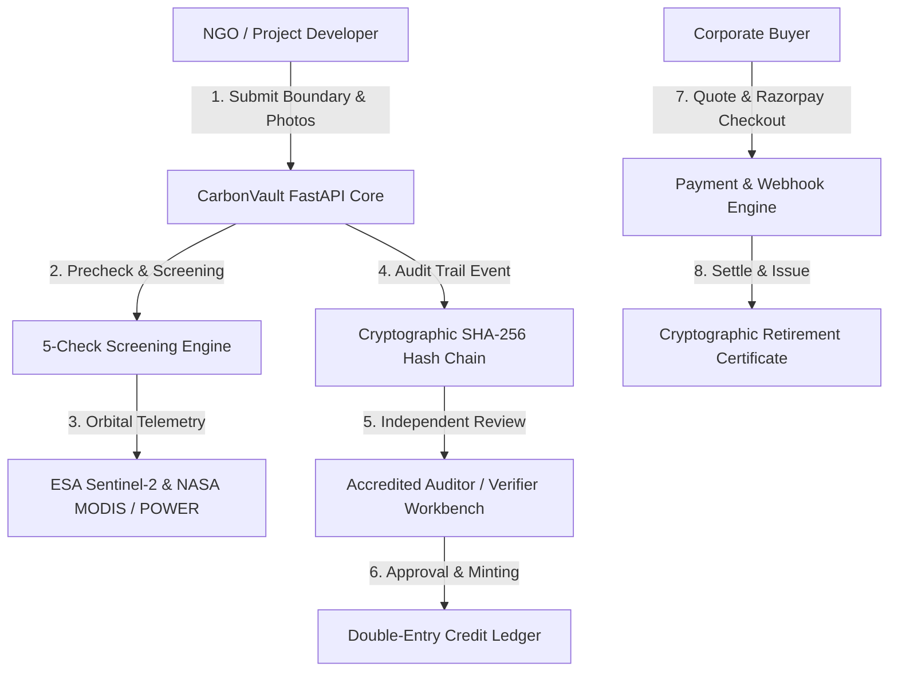

# CarbonVault — How It Works

CarbonVault is an enterprise-grade digital carbon credit MRV (Measurement, Reporting, and Verification) platform and marketplace. It connects verified reforestation and afforestation projects with corporate buyers through multi-spectral satellite telemetry, cryptographic ledger integrity, and automated pre-issuance fraud screening.

---

## 1. System Architecture

---

## 2. The Verification & Issuance Lifecycle

### Stage 1: Registration & Pre-Flight Screening
1. **Boundary & Allometric Submission**:
   - The developer submits project location (centroid and polygon coordinates), plantation type (e.g. mangrove, bamboo, reforestation), area in hectares, tree count, and initial field photos.
2. **Automated Screening (Task D Pipeline)**:
   - Evaluates boundary consistency (±10% area match, zero registry overlap).
   - Validates embedded camera EXIF GPS metadata against site centroid (<= 25 km).
   - Verifies multi-orientation image uniqueness via perceptual hashing (Hamming distance > 10 bits).
   - Establishes satellite baseline NDVI and evaluates 7 biometric features via an Isolation Forest.
   - Non-accusatory review status: **Looks consistent**, **Needs attention**, or **Needs manual review**.

### Stage 2: Telemetry Synchronization & Monitoring
1. **Satellite Vegetation Tracking**:
   - Real MODIS (ORNL DAAC) and Sentinel-2 surface reflectance tracks NDVI quarterly.
   - NASA POWER daily agroclimatology supplies precipitation, temperature, and relative humidity.
2. **Grounded Explanations**:
   - Claude 3.5 Sonnet / Haiku provides grounded narrative summaries strictly cross-checked against numerical facts in the database to prevent hallucinations.

### Stage 3: Independent Auditor Sign-Off
1. **Document Verification Gate**:
   - 4 mandatory legal documents: Land Title / Concession Proof, Methodology Reference, Monitoring Plan, and Baseline Survey.
2. **Accredited Determination**:
   - Verifier signs off under ISO 14064-3 standards, emitting a tamper-evident audit record.

### Stage 4: Double-Entry Credit Minting & Trading
1. **Ledger Balances**:
   - Total credits, shadow credits (forward vintage), and available inventory are balanced with strict constraints preventing double-spending.
2. **Dynamic Pricing & Forex**:
   - Dual-currency settlement in USD and INR with real-time FX rate caching and 15-minute quote locks.

### Stage 5: Payment Settlement & Retirement
1. **Razorpay Checkout**:
   - Secured order generation with HMAC-SHA256 signature verification.
2. **Retirement Certificate**:
   - Minted with unique serial number, buyer corporate entity, tonnes retired, and immutable SHA-256 audit fingerprint with public verification at `/certificates/{id}`.

---

## 3. Technology Stack

- **Frontend**: React 18, Vite, Vanilla CSS tokens, Lucide Icons, Leaflet / OpenStreetMap.
- **Backend**: FastAPI (Python 3.10+), SQLAlchemy 2.0, Pydantic v2, APScheduler.
- **Database**: PostgreSQL (Production on Render) / SQLite (Local dev).
- **Machine Learning**: Scikit-Learn (Isolation Forest), ImageHash, Shapely, NumPy, Statsmodels.
- **External Telemetry**: NASA POWER API, ORNL DAAC MODIS REST API, Open-Meteo, Razorpay API.
