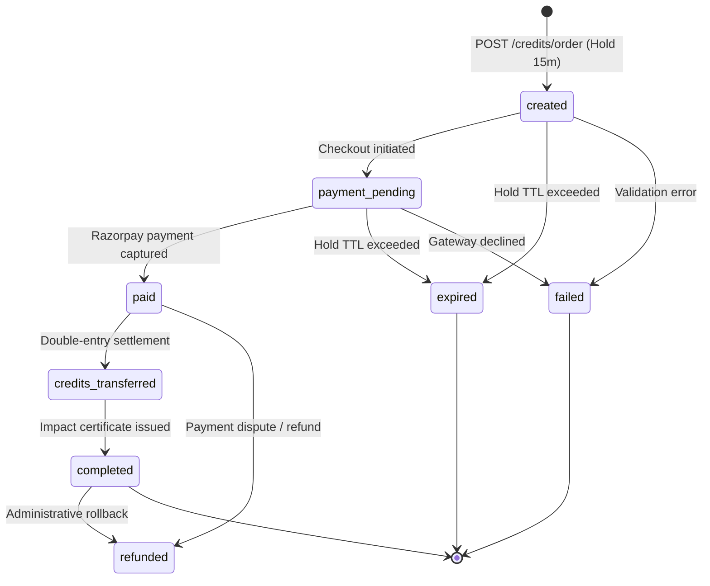

# CarbonVault Credit Integrity & Accounting Methodology

**Document Version:** 1.0.0  
**Methodology Standard:** AFOLU VCS Non-Permanence Risk Tool v4.0 & GHG Protocol Corporate Standard  
**Applicability:** All forestry, blue carbon, mangrove restoration, and soil carbon sequestration assets listed on CarbonVault.

---

## 1. Executive Summary & Purpose

CarbonVault enforces cryptographic and double-entry accounting integrity across every carbon credit minted, reserved, sold, and retired. In nature-based carbon projects (AFOLU — Agriculture, Forestry, and Other Land Use), carbon sequestered in biomass carries inherent risks of unintentional reversal (such as forest fires, drought, pests, disease, or illegal logging).

To ensure that 1 tonne of $\text{CO}_2$ retired on CarbonVault corresponds unconditionally to 1 permanent tonne of net atmospheric carbon reduction, the platform institutes:
1. **Configurable Permanence Buffer Reserves** withheld at issuance from public sale.
2. **Double-Entry Ledger Accounting** where every transfer consists of balancing credit/debit legs.
3. **Atomic Serial Range Slicing** ensuring no two buyers can ever claim or hold the same serial number.
4. **Order State Machine with Row-Level Locking** preventing overselling under high concurrency.
5. **Irreversible Retirement Sink** guaranteeing that retired credits can never return to circulation.
6. **Automated Nightly Reconciliation** ensuring mathematically verifiable conservation of credits.

---

## 2. Permanence Buffer Pool & Reversal Risk Mitigation

### 2.1 The Reversal Risk Problem
Unlike geological carbon capture and mineralization, biological carbon sequestration is vulnerable to disturbance events. If a project credits 10,000 tonnes and 1,500 tonnes burn in a wildfire 3 years later, unmitigated credits would represent non-existent carbon removals ("phantom credits").

### 2.2 Buffer Pool Mechanism
At the moment of minting any verified credit batch, CarbonVault automatically calculates and withholds a non-tradable buffer reserve into a dedicated pooled platform escrow account (`ACC-SYS-BUFFER`).

The buffer share percentage ($\beta$) is stored in the dynamic `system_config` table:
- **Default Parameter:** `buffer_pool_share` = `0.15` (15.0%) to `0.20` (20.0%)
- **Governance:** Configurable strictly by administrators with an immutable audit trail logged to `config_audit_history`.

### 2.3 Buffer Calculation Equation
For a verified credit issuance of $Q_{\text{total}}$ tonnes:

$$Q_{\text{buffer}} = \left\lfloor Q_{\text{total}} \times \frac{\beta}{100} \right\rfloor$$

$$Q_{\text{available}} = Q_{\text{total}} - Q_{\text{buffer}}$$

Where:
- $Q_{\text{total}}$ is the total verified net carbon sequestration verified by satellite telemetry and field audit.
- $Q_{\text{buffer}}$ is deposited immediately to `ACC-SYS-BUFFER` and is blocked from listing, reservation, or purchase.
- $Q_{\text{available}}$ is deposited into `ACC-SYS-INVENTORY` for marketplace listing.

---

## 3. Atomic Serial Range Slicing

Every carbon credit on CarbonVault possesses a globally unique, contiguous, integer serial number. Serial numbers are vintage-specific and project-specific.

### 3.1 Batch Serial Range
When batch $i$ is minted with quantity $Q_{\text{total}}$:
$$\text{serial\_start}_i = \text{serial\_end}_{i-1} + 1$$
$$\text{serial\_end}_i = \text{serial\_start}_i + Q_{\text{total}} - 1$$

### 3.2 Sub-allocation Slicing
When a corporate order purchases quantity $q \le Q_{\text{available}}$:
1. The batch is locked via database row-level lock (`with_for_update()`).
2. The order is assigned an immutable slice:
   $$\text{serial\_start}_{\text{order}} = \text{batch.serial\_start} + \text{offset}$$
   $$\text{serial\_end}_{\text{order}} = \text{serial\_start}_{\text{order}} + q - 1$$
3. The slice is recorded in the `orders` table and reflected in `ledger_entries`.
4. Serial ranges are strictly non-overlapping:

$$\forall (a, b), \quad a \neq b \implies [\text{start}_a, \text{end}_a] \cap [\text{start}_b, \text{end}_b] = \emptyset$$

---

## 4. Order State Machine & Concurrency Control

Orders follow an uncompromising, unidirectional finite state machine (FSM).



### 4.1 Legal State Transitions
| From State | Allowed To States | Rationale |
|---|---|---|
| `created` | `payment_pending`, `expired`, `failed` | Order created and inventory locked for 15 minutes. |
| `payment_pending` | `paid`, `failed`, `expired` | Buyer directed to Razorpay checkout; awaiting webhook or confirmation. |
| `paid` | `credits_transferred`, `refunded` | Payment confirmed; pending atomic ledger balance movement. |
| `credits_transferred` | `completed` | Credits moved from inventory to buyer account; finalizing certificate. |
| `completed` | `refunded` | Order complete; terminal unless refunded. |
| `expired` / `failed` | None (Terminal) | Expired holds return inventory to available pool via reaper. |

### 4.2 Concurrency Defense: Row-Level Locking (`with_for_update()`)
To prevent race conditions where two simultaneous transactions attempt to reserve the final remaining credits:
```sql
SELECT * FROM credit_batches 
WHERE project_id = :project_id AND available_quantity >= :qty 
FOR UPDATE;
```
1. The first concurrent transaction acquires exclusive access to the batch row.
2. The second transaction blocks until the first completes.
3. If the first transaction exhausts the available balance, the second immediately raises `CreditIntegrityError("Insufficient inventory")`, preventing overselling.

### 4.3 15-Minute Hold TTL & Expired Reservation Reaper
- Orders in `created` or `payment_pending` hold inventory for exactly 15 minutes (`reservation_expires_at = now + 15m`).
- A background worker (`worker.py --job reap-reservations`) runs every 60 seconds:
  1. Identifies orders where `status IN ('created', 'payment_pending')` and `reservation_expires_at < now`.
  2. Transitions order status to `expired`.
  3. Increments batch `available_quantity` and decrements `reserved_quantity`.
  4. Records a double-entry release ledger entry.

---

## 5. Double-Entry Accounting & Ledger Architecture

Every balance change on CarbonVault is recorded in `ledger_entries`. Direct balance mutations without a corresponding ledger entry are strictly prohibited.

### 5.1 System Accounts
| Account ID | Type | Role |
|---|---|---|
| `ACC-SYS-MINT` | `system_mint` | Genesis issuance source account. |
| `ACC-SYS-INVENTORY` | `system_inventory` | Available marketplace inventory pool. |
| `ACC-SYS-BUFFER` | `system_buffer` | Permanence risk reserve sink. |
| `ACC-SYS-RETIRED` | `system_retired` | Irreversible public retirement sink. |
| `ACC-ORG-{UUID}` | `organisation` | Verified corporate buyer holding account. |

### 5.2 Transaction Types & Journal Entries
1. **Minting:**
   - Debit: `ACC-SYS-MINT`
   - Credit: `ACC-SYS-INVENTORY` ($Q_{\text{available}}$)
   - Credit: `ACC-SYS-BUFFER` ($Q_{\text{buffer}}$)
2. **Order Settlement:**
   - Debit: `ACC-SYS-INVENTORY` ($q$)
   - Credit: `ACC-ORG-{UUID}` ($q$)
3. **Retirement:**
   - Debit: `ACC-ORG-{UUID}` ($q_{\text{retire}}$)
   - Credit: `ACC-SYS-RETIRED` ($q_{\text{retire}}$)

---

## 6. Public Retirement Registry & Non-Transferability Invariant

### 6.1 The Non-Transferability Invariant
Once credits enter `ACC-SYS-RETIRED`:
$$\forall t > t_{\text{retire}}, \quad \text{Transfer}(\text{ACC-SYS-RETIRED}, \text{AnyAccount}) = \text{FORBIDDEN}$$

Attempting to debit `ACC-SYS-RETIRED` immediately triggers an unrecoverable `CreditIntegrityError`.

### 6.2 Public Verification Endpoint
All retirements are exposed in the public registry (`/registry/retirements` and `/registry/retirements/{certificate_id}`). Each certificate details:
- Unique Certificate ID (`CERT-RET-XXXXXXXX`)
- Beneficiary corporate name
- Purpose & ESG declaration
- Project and vintage year
- Serial range claimed (`00001201 - 00001500`)
- Timestamp and permanent retirement confirmation

---

## 7. Nightly Reconciliation Engine

The reconciliation engine (`core/reconciliation.py` and `worker.py --job reconcile`) audits all accounts, batches, and orders nightly at midnight UTC.

### 7.1 Conservation Equations
For every batch $b \in \text{Batches}$:
$$Q_{\text{minted}}(b) = Q_{\text{available}}(b) + Q_{\text{reserved}}(b) + Q_{\text{retired}}(b) + Q_{\text{buffer}}(b) + Q_{\text{owned}}(b)$$

Across all platform accounts:
$$\sum_{a \in \text{Accounts} \setminus \{\text{MINT}\}} \text{Balance}(a) = \sum_{b \in \text{Batches}} Q_{\text{minted}}(b)$$

Across all account balances:
$$\forall a \in \text{Accounts}, \quad \text{Balance}(a) \ge 0$$

Across all completed orders:
$$\forall o \in \text{Orders}_{\text{completed}}, \quad \exists e \in \text{LedgerEntries} : e.\text{order\_id} = o.\text{order\_id}$$

### 7.2 Discrepancy Handling
If any discrepancy is detected:
1. Critical structured alert is logged.
2. System `Notification` is dispatched to all platform administrators.
3. Incident is appended to the cryptographic hash chain in `audit_logs`.
