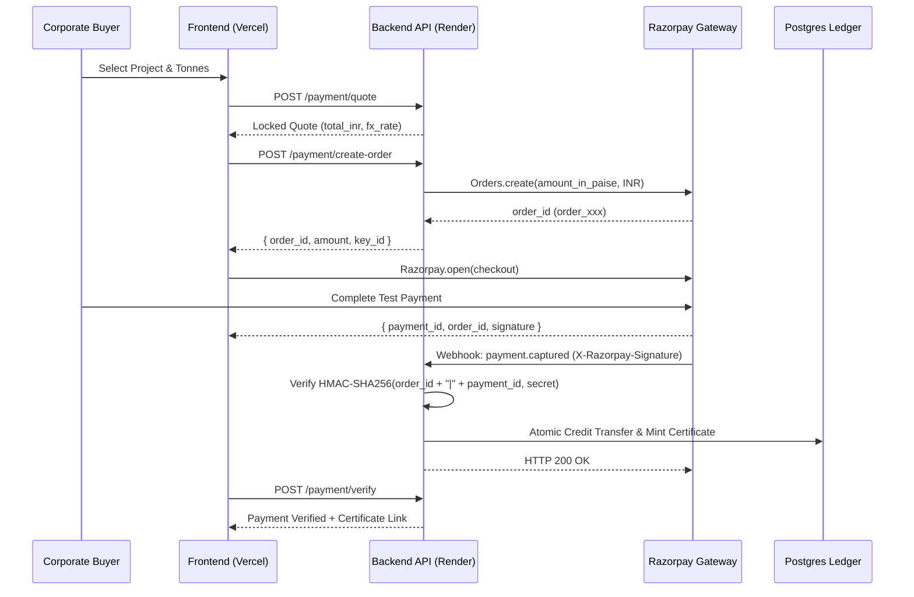

# CarbonVault — Payments & Financial Settlement Engine

CarbonVault features a multi-currency payment and double-entry settlement engine built on the Razorpay API. It supports dual-currency quotes (USD base with live INR conversion), cryptographic webhook validation, and atomic credit retirement.

---

## 1. Dual-Currency Pricing & Quote Locks

1. **Live Exchange Rate Engine**:
   - Primary source: Open-Meteo FX / Central Bank exchange rate feeds.
   - Cached in `fx_rates` table with timestamp and fallback defaults (e.g. 1 USD = 83.50 INR).
   - Admin override supported via `/config/fx-rate`.
2. **15-Minute Payment Quotes**:
   - When a buyer initiates purchase, the system mints a unique `PaymentQuote` (`QTE-uuid`).
   - Locks the USD/INR exchange rate and credit unit price for 15 minutes to eliminate currency volatility during checkout.
   - Reused quotes or expired quotes (> 15 min) are automatically rejected.

---

## 2. Razorpay Integration Architecture



---

## 3. Security Invariants & Invariant Protections

### 1. Robust Whitespace & Credential Sanitization
To prevent authentication failures caused by accidental trailing spaces or newlines pasted into cloud environment consoles, `core/settings.py` applies Pydantic string stripping:
```python
@field_validator("RAZORPAY_KEY_ID", "RAZORPAY_KEY_SECRET", "RAZORPAY_WEBHOOK_SECRET", mode="before")
@classmethod
def strip_env_strings(cls, v):
    return v.strip() if isinstance(v, str) else v
```

### 2. Prefix Validation
The engine automatically verifies consistency between configuration mode and API key prefixes:
- Test Mode (`PAYMENT_MODE=test`): Key ID must start with `rzp_test_`.
- Live Mode (`PAYMENT_MODE=live`): Key ID must start with `rzp_live_`.

### 3. Test Mode Transaction Cap
In test mode, order amounts exceeding ₹5,00,000 (~$6,000 USD) are automatically rejected to prevent accidental volume distortion during integration testing.

### 4. Cryptographic Webhook HMAC Verification
Webhooks from Razorpay must include the `X-Razorpay-Signature` header. The backend validates the signature using constant-time comparison:
```python
generated_signature = hmac.new(
    webhook_secret.encode("utf-8"),
    payload_body,
    hashlib.sha256
).hexdigest()

if not hmac.compare_digest(generated_signature, received_signature):
    raise HTTPException(status_code=400, detail="Invalid signature")
```

---

## 4. Double-Entry Settlement & Certificate Minting

Upon successful payment capture:
1. **Ledger Balance Update**:
   - Debits project verified credits from `Project.credits` and credit batch.
   - Credits corporate buyer wallet in `Wallet` table.
2. **Cryptographic Certificate Generation**:
   - Generates unique public ID: `CRT-PREFIX-RANDOM` (e.g. `CRT-MAN-AMAZON`).
   - Calculates SHA-256 authenticity fingerprint of:
     `{certificate_id}:{project_id}:{buyer_name}:{tonnes}:{issued_at}`
   - Generates printable PDF certificate signed with platform HMAC.
   - Publicly auditable at `/certificates/{id}` without requiring login.

---

## 5. Owner Setup Checklist (Render & Razorpay)

### Target Service Identification
> [!IMPORTANT]
> Render runs multiple services for CarbonVault:
> - `carbonvault-api` (Web Service — **this is the service where payments run**)
> - `carbonvault-worker` (Background Worker)
> - `carbonvault-postgres` (Managed Database)
>
> You must configure Razorpay environment variables on **`carbonvault-api`**.

### Step 1: Obtain Razorpay Test Keys
1. Sign in to your [Razorpay Dashboard](https://dashboard.razorpay.com/).
2. In the top navbar, ensure your toggle is set to **Test Mode** (orange indicator).
3. From the left sidebar, navigate to **Account & Settings** → **API Keys** (under *Website and app settings*).
4. Click **Generate Test Key** (or **Regenerate Test Key** if you have misplaced the secret).
5. Copy both:
   - **Key Id** (starts with `rzp_test_...`)
   - **Key Secret** (a long alphanumeric string)

### Step 2: Configure Environment on Render (`carbonvault-api`)
1. Go to [dashboard.render.com](https://dashboard.render.com/).
2. Click on the web service named **`carbonvault-api`**.
3. In the left navigation menu, click **Environment**.
4. Set or verify the following variables:

| Variable Name | Required Value / Example | Notes |
| :--- | :--- | :--- |
| `PAYMENT_MODE` | `test` | Must match key prefix (`test` ↔ `rzp_test_`) |
| `RAZORPAY_KEY_ID` | `rzp_test_...` | Public Key ID from Step 1 |
| `RAZORPAY_KEY_SECRET` | `...` | Secret Key from Step 1 |
| `RAZORPAY_WEBHOOK_SECRET` | `whsec_...` | Optional in test mode, required in live mode |

> [!TIP]
> The backend automatically sanitizes environment values by stripping leading/trailing whitespace and surrounding quotes (`"..."` or `'...'`) that can be accidentally added when pasting in the Render UI.

5. Click **Save Changes**. Render will automatically trigger a rolling redeploy.

### Step 3: Self-Test Verification Command
Once the redeploy finishes, run this command in your terminal or browser to verify gateway health:

```bash
curl -s https://carbonvault-api.onrender.com/ready
```

Inspect the `razorpay` and `razorpay_diagnostics` fields in the JSON response:
```json
{
  "status": "ready",
  "razorpay": "ok",
  "razorpay_status": "ok",
  "razorpay_key_hint": "rzp_test_••••Ieed",
  "razorpay_diagnostics": {
    "status": "ok",
    "key_hint": "rzp_test_••••Ieed",
    "http_status": 200,
    "error_code": null,
    "error_description": null
  }
}
```

### Gateway Health Diagnostics Reference

| `razorpay` Status | Meaning | Action Needed |
| :--- | :--- | :--- |
| `ok` | Credentials authenticated with Razorpay API. | None — checkout is fully operational. |
| `auth_failed` | Key ID and Key Secret rejected by Razorpay (HTTP 401). | Check for mistyped secret in Render `carbonvault-api` Environment. Regenerate key in Razorpay dashboard if needed. |
| `missing` | Either `RAZORPAY_KEY_ID` or `RAZORPAY_KEY_SECRET` is blank. | Add both variables in Render `carbonvault-api` Environment tab. |
| `unreachable` | Connection to Razorpay API timed out or returned HTTP 5xx. | Check Razorpay status page or network connectivity from Render. |

---

## 6. Testing Checkout in the Frontend

When testing checkout on `https://final-carbon-vault.vercel.app` (or local `http://localhost:5173`):
1. Sign in as Corporate Buyer (`James Chen`).
2. Go to **Marketplace** → Click **Buy** on any project.
3. Select a quantity (e.g., 25–50 tonnes; keep total under ₹5,00,000 for Razorpay test mode).
4. When the Razorpay checkout modal opens, use standard Razorpay test credentials:
   - **Card Number**: `4111 1111 1111 1111` (or any valid card number)
   - **Expiry**: Any future date (e.g., `12/28`)
   - **CVV**: `123`
   - **OTP**: `123456` (or click "Success" in the test prompt)
5. Upon completion, the backend mints a cryptographic certificate and updates the corporate wallet.

