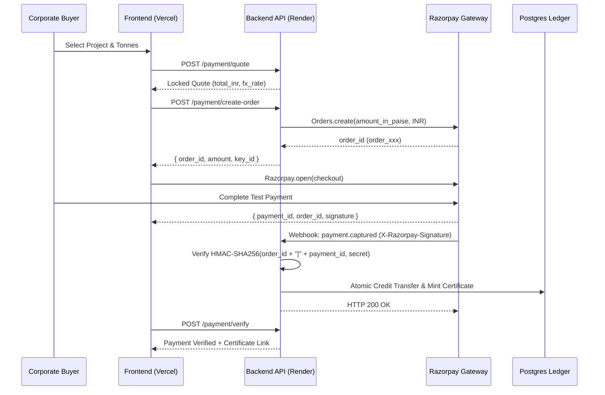

# CarbonVault — Payments & Financial Settlement Engine

CarbonVault features a multi-currency payment and double-entry settlement engine built on the Razorpay API. It supports dual-currency quotes (USD base with live INR conversion), cryptographic webhook validation, and atomic credit retirement.

---

## 1. Dual-Currency Pricing & Quote Locks

1. **Live Exchange Rate Engine**:
   - Primary source: Open-Meteo FX / Central Bank exchange rate feeds.
   - Cached in `fx_rates` table with timestamp and fallback defaults (e.g. 1 USD = 83.50 INR).
   - Admin override supported via `/config/fx-rate`.
2. **15-Minute Payment Quotes**:
   - When a buyer initiates purchase, the system mints a unique `PaymentQuote` (`QTE-uuid`).
   - Locks the USD/INR exchange rate and credit unit price for 15 minutes to eliminate currency volatility during checkout.
   - Reused quotes or expired quotes (> 15 min) are automatically rejected.

---

## 2. Razorpay Integration Architecture



---

## 3. Security Invariants & Invariant Protections

### 1. Robust Whitespace & Credential Sanitization
To prevent authentication failures caused by accidental trailing spaces or newlines pasted into cloud environment consoles, `core/settings.py` applies Pydantic string stripping:
```python
@field_validator("RAZORPAY_KEY_ID", "RAZORPAY_KEY_SECRET", "RAZORPAY_WEBHOOK_SECRET", mode="before")
@classmethod
def strip_env_strings(cls, v):
    return v.strip() if isinstance(v, str) else v
```

### 2. Prefix Validation
The engine automatically verifies consistency between configuration mode and API key prefixes:
- Test Mode (`PAYMENT_MODE=test`): Key ID must start with `rzp_test_`.
- Live Mode (`PAYMENT_MODE=live`): Key ID must start with `rzp_live_`.

### 3. Test Mode Transaction Cap
In test mode, order amounts exceeding ₹5,00,000 (~$6,000 USD) are automatically rejected to prevent accidental volume distortion during integration testing.

### 4. Cryptographic Webhook HMAC Verification
Webhooks from Razorpay must include the `X-Razorpay-Signature` header. The backend validates the signature using constant-time comparison:
```python
generated_signature = hmac.new(
    webhook_secret.encode("utf-8"),
    payload_body,
    hashlib.sha256
).hexdigest()

if not hmac.compare_digest(generated_signature, received_signature):
    raise HTTPException(status_code=400, detail="Invalid signature")
```

---

## 4. Double-Entry Settlement & Certificate Minting

Upon successful payment capture:
1. **Ledger Balance Update**:
   - Debits project verified credits from `Project.credits` and credit batch.
   - Credits corporate buyer wallet in `Wallet` table.
2. **Cryptographic Certificate Generation**:
   - Generates unique public ID: `CRT-PREFIX-RANDOM` (e.g. `CRT-MAN-AMAZON`).
   - Calculates SHA-256 authenticity fingerprint of:
     `{certificate_id}:{project_id}:{buyer_name}:{tonnes}:{issued_at}`
   - Generates printable PDF certificate signed with platform HMAC.
   - Publicly auditable at `/certificates/{id}` without requiring login.

---

## 5. Owner Setup Checklist (Render & Vercel)

### Step 1: Render Environment Variables
Ensure the following variables are set in your Render Dashboard (`Environment` tab):

| Variable Name | Example Value | Description |
| :--- | :--- | :--- |
| `PAYMENT_MODE` | `test` | `test` or `live` |
| `RAZORPAY_KEY_ID` | `rzp_test_YourKeyID` | From Razorpay Dashboard -> Settings -> API Keys |
| `RAZORPAY_KEY_SECRET` | `YourKeySecret` | Secret key corresponding to Key ID |
| `RAZORPAY_WEBHOOK_SECRET` | `YourWebhookSecret` | Secret string configured in Razorpay Webhooks |

### Step 2: Configure Razorpay Webhook
1. Go to [Razorpay Dashboard](https://dashboard.razorpay.com/) -> **Settings** -> **Webhooks**.
2. Click **Add New Webhook**.
3. **Webhook URL**: `https://carbonvault-api.onrender.com/payment/webhook`
4. **Secret**: Enter the exact secret string you put in `RAZORPAY_WEBHOOK_SECRET`.
5. **Active Events**: Check `payment.captured` and `payment.failed`.

### Step 3: Test Payment Cards
When testing checkout on `https://final-carbon-vault.vercel.app`:
- **Card Number**: Use standard Razorpay test card `4012 0000 0000 0002` (or any valid test card).
- **Expiry**: Any future date (e.g., `12/28`).
- **CVV**: `123`.
- **OTP**: Enter `1234` or click "Success" in the Razorpay test modal.
